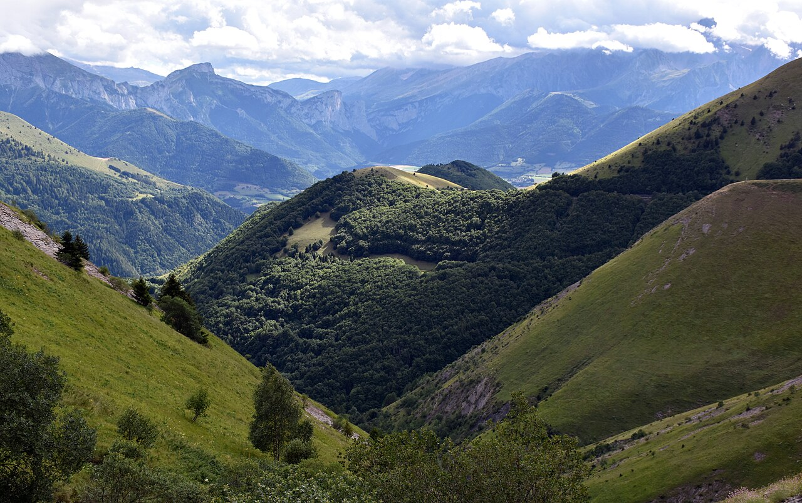
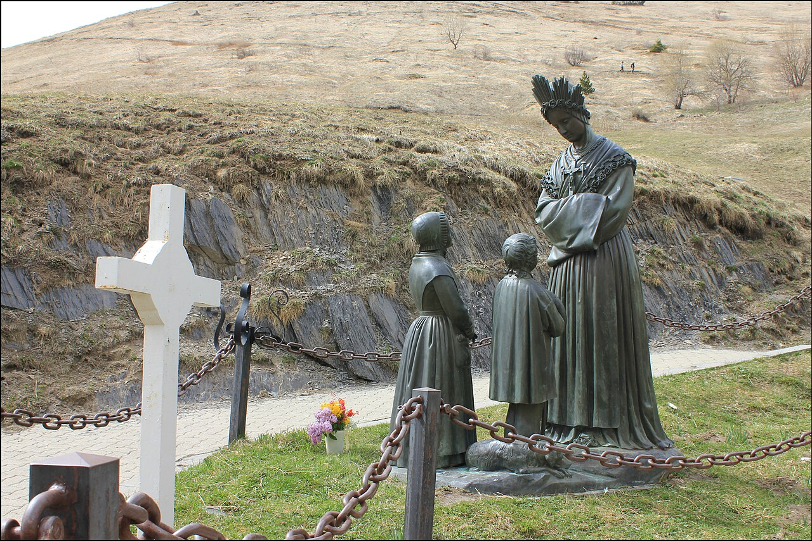
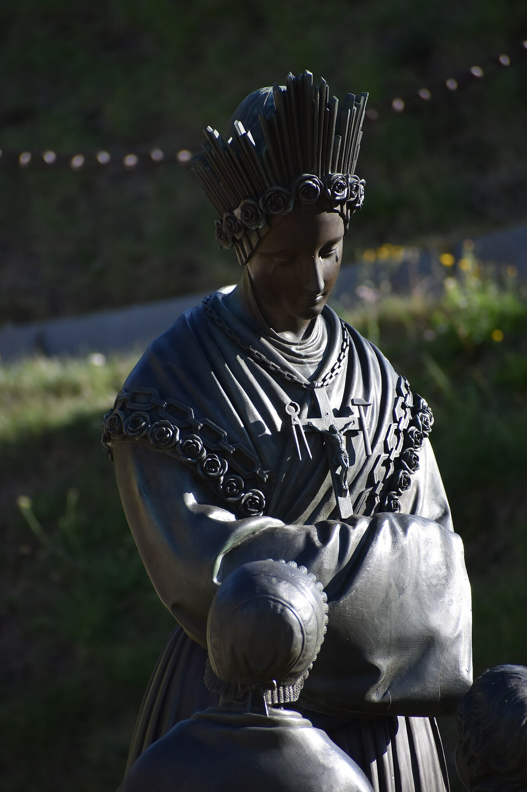
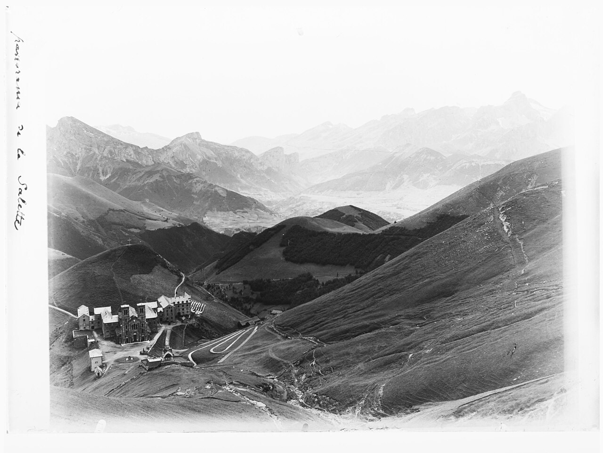
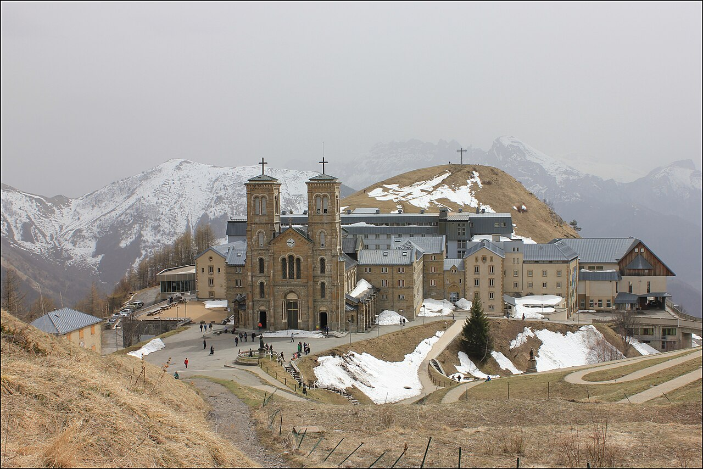
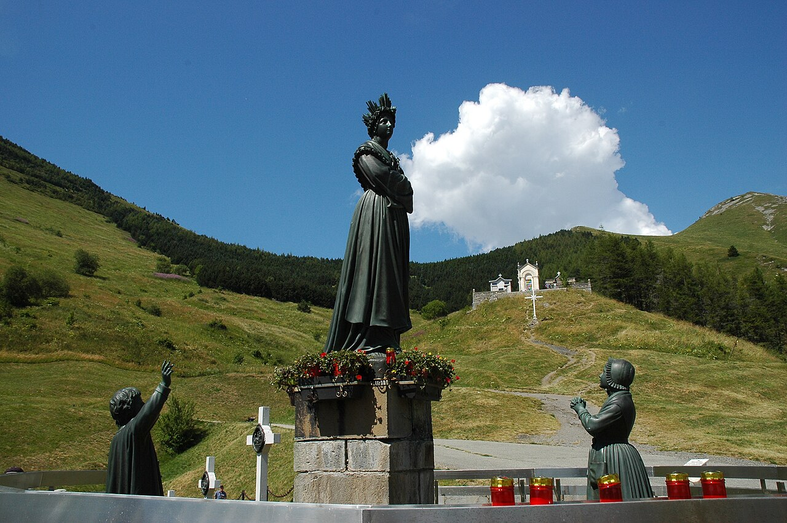

Entre todas as aparições de Nossa Senhora reconhecidas pela Igreja, poucas são tão comoventes quanto a de La Salette. Ali, no alto de uma montanha dos Alpes franceses, Maria não apareceu sorrindo nem cercada de anjos. Ela apareceu sentada numa pedra, com o rosto escondido entre as mãos, chorando. Foi assim que duas crianças pobres a encontraram numa tarde de setembro de 1846: como uma mãe aflita, que sofre ao ver os filhos se afastarem de Deus.

Neste artigo, vamos contar com calma a história dessa aparição: o que aconteceu naquele dia, o que Nossa Senhora disse, quem eram os dois videntes, como a Igreja investigou o caso e por que a mensagem de La Salette continua tão atual. Também vamos falar dos famosos "segredos", separando com cuidado o que é fato comprovado do que é polêmica. No fim, você vai perceber que as lágrimas de Maria não são uma ameaça, mas um chamado cheio de amor para voltarmos a Jesus.

## A França de 1846

Para entender a aparição de Nossa Senhora em Salette, é preciso entender o contexto da França daquela época. Pouco mais de cinquenta anos antes, em 1789, começou a Revolução Francesa. O que no início parecia apenas uma revolta contra os abusos do rei e da nobreza logo se voltou com força contra a Igreja. Em 1790, o governo revolucionário exigiu que os padres jurassem fidelidade a uma nova organização da Igreja controlada pelo Estado, separada da autoridade do Papa. Os que se recusaram a fazer esse juramento passaram a ser tratados como inimigos da nação: milhares foram presos, deportados ou obrigados a fugir do país, e muitos foram mortos. Só nos chamados Massacres de Setembro, em 1792, centenas de padres foram assassinados nas prisões de Paris.

Nos anos seguintes, a perseguição ficou ainda mais radical. Igrejas foram fechadas, saqueadas ou transformadas em depósitos e estábulos; sinos foram derretidos para fazer canhões; conventos foram esvaziados. Na própria catedral de Notre-Dame de Paris, os revolucionários chegaram a celebrar um "culto à Razão" no lugar da Missa. Para se ter ideia, o governo criou um novo calendário, com semanas de dez dias, justamente para apagar o domingo da vida do povo. Quando Napoleão assinou um acordo com o Papa, em 1801, as igrejas puderam reabrir e o culto voltou a ser permitido. Mas o estrago já estava feito: toda uma geração tinha crescido sem catecismo, sem padres e sem Missa. No interior, onde ficava Salette, a religião tinha virado para muitos apenas um costume: poucos rezavam, o domingo era tratado como um dia qualquer de trabalho e era comum ouvir o nome de Deus usado em palavrões.

Além da crise espiritual, a Europa enfrentava uma crise de fome. Em 1845, chegou ao continente uma doença das plantas, causada por um micro-organismo parecido com um fungo, que atacava as plantações de batata. As folhas escureciam, e as batatas apodreciam na terra ou pouco depois de colhidas, soltando um cheiro forte. Isso foi uma tragédia, porque a batata era a comida mais barata e a base da alimentação das famílias pobres em muitos países. A situação mais grave foi a da Irlanda, onde a chamada Grande Fome matou cerca de um milhão de pessoas e obrigou outro milhão a deixar o país em busca de sobrevivência.

Na França, a praga das batatas veio acompanhada de uma colheita de trigo muito ruim justamente em 1846, o ano da aparição. O preço do pão subiu muito, e no inverno seguinte houve revoltas de pessoas famintas em várias regiões do país. Nas montanhas pobres em volta da Salette, onde as famílias viviam do pouco que plantavam, o medo de passar fome era real e diário. Foi nesse cenário de pobreza material e espiritual que Nossa Senhora escolheu aparecer, falando justamente da vida concreta daquele povo: do trabalho, das colheitas, do pão de cada dia e, acima de tudo, da relação deles com Deus.

## O que aconteceu em 19 de setembro de 1846

{total}

No sábado, 19 de setembro de 1846, véspera da festa de Nossa Senhora das Dores, duas crianças cuidavam de vacas num pasto a cerca de 1.800 metros de altitude, acima do vilarejo de La Salette, no sudeste da França. Eram Melânia Calvat, de 14 anos, e Maximino Giraud, de 11. Os dois vinham de famílias muito pobres da cidadezinha de Corps, não sabiam ler nem escrever e mal conheciam o catecismo. Tinham se conhecido apenas dois dias antes, porque trabalhavam para patrões diferentes que eram vizinhos. Depois do almoço, cansados pelo calor, os dois cochilaram na grama, coisa que não costumavam fazer.

Quando acordaram, por volta das três da tarde, saíram correndo para procurar as vacas. Foi então que Melânia viu, perto de um pequeno riacho seco, um globo de luz muito forte, mais brilhante que o sol. A luz se abriu e, dentro dela, apareceu uma mulher sentada numa pedra, com os cotovelos sobre os joelhos e o rosto entre as mãos, chorando. As crianças ficaram paralisadas de medo. A Senhora, então, levantou-se, cruzou os braços e disse com voz doce:

::: citacao Nossa Senhora de La Salette
Avancem, meus filhos, não tenham medo. Estou aqui para lhes contar uma grande notícia.
:::

Os dois se aproximaram tanto que, segundo contaram depois, ninguém poderia passar entre eles e ela.

{50% direita}

Durante toda a conversa, as lágrimas não pararam de correr pelo rosto da Senhora. Ela começou falando em francês, mas, quando percebeu que as crianças não entendiam bem certas palavras, passou a falar no dialeto da região, a língua simples que eles usavam em casa. Ao final, caminhou alguns passos, subiu uma pequena encosta, elevou-se no ar e desapareceu aos poucos na luz. As crianças não sabiam quem ela era. Melânia comentou apenas: "Talvez fosse uma grande santa." Só mais tarde, ao contarem tudo aos adultos, é que todos começaram a se perguntar se aquela "Bela Senhora" não seria a própria Virgem Maria.

## A mensagem de Nossa Senhora

A mensagem de La Salette foi conservada com muito cuidado, porque as duas crianças a repetiram centenas de vezes, separadamente, diante de padres, autoridades e curiosos, sempre com as mesmas palavras. Ela começa com uma frase forte: "Se o meu povo não quiser se submeter, serei obrigada a deixar cair o braço do meu Filho. Ele é tão forte e tão pesado que não posso mais segurá-lo." Logo em seguida, Maria explica que sofre há muito tempo por nossa causa e que precisa rezar sem parar para que seu Filho não nos abandone. A imagem é a de uma mãe que se coloca entre os filhos e as consequências dos seus erros, intercedendo por eles até o limite das forças.

Em seguida, a Senhora aponta, de forma muito concreta, os pecados que "tornam tão pesado o braço do seu Filho". O primeiro é o desprezo pelo domingo: "Eu vos dei seis dias para trabalhar, reservei para mim o sétimo, e não querem me concedê-lo." O segundo é a blasfêmia: os carroceiros, diz ela, não sabem praguejar sem usar o nome do seu Filho. Ela também lamenta que quase ninguém mais respeite a Quaresma, que poucos vão à Missa — apenas "algumas mulheres mais idosas" no verão — e que, no inverno, muitos só vão à igreja para zombar da religião.

Depois, Maria liga esses pecados ao sofrimento que o povo já estava vivendo. Ela fala das batatas que estavam apodrecendo, anuncia que o trigo viraria pó, que as nozes e as uvas se estragariam e que viria uma grande fome. Mas logo acrescenta uma promessa cheia de esperança: se o povo se converter, "as pedras e os rochedos se transformarão em montes de trigo". Ou seja, Deus não quer castigar; quer que seus filhos voltem para Ele.

Há um momento da conversa que mostra bem o carinho de Maria. Ela pergunta às crianças: "Vocês fazem bem a sua oração, meus filhos?" Os dois respondem com sinceridade: "Quase nada, Senhora." Em vez de repreendê-los, ela ensina com paciência que é preciso rezar de manhã e à noite, nem que seja apenas um Pai-Nosso e uma Ave-Maria, e rezar mais quando puderem. Depois, lembra a Maximino um episódio que ele mesmo tinha esquecido: um dia em que ele e o pai, numa fazenda chamada Coin, encontraram o trigo estragado, e o pai, preocupado, lhe deu um pedaço de pão dizendo para comer enquanto ainda havia pão naquele ano. Esse detalhe, que ninguém além dos dois conhecia, impressionou muito o pai de Maximino e ajudou a convencê-lo de que a aparição era verdadeira.

A mensagem termina com um pedido que se tornaria o lema de La Salette. A Senhora disse duas vezes:

::: citacao Nossa Senhora de La Salette
Pois bem, meus filhos, transmitam isso a todo o meu povo.
:::

Aquelas duas crianças simples, que nem sabiam ler, receberam a missão de levar o recado da Mãe ao mundo inteiro.

## Os sinais: as lágrimas, o crucifixo, as correntes e as rosas

{40% esquerda}

Na Salette, cada detalhe da aparência de Nossa Senhora parece ter um sentido. As crianças a descreveram vestida de luz, com um longo vestido branco cheio de brilho, um avental dourado e um xale branco bordado com rosas. Na cabeça, usava uma coroa alta, também enfeitada com rosas. Sobre os ombros, trazia uma corrente pesada e, ao lado dela, outra corrente mais leve, de onde pendia um crucifixo. Junto aos braços da cruz havia, de um lado, um martelo e, do outro, uma tenaz, a ferramenta usada para arrancar pregos. Do crucifixo saía a luz que iluminava toda a figura de Maria.

A tradição da Igreja e os Missionários de La Salette costumam explicar esses símbolos de modo bem simples. O martelo lembra os nossos pecados, que, por assim dizer, pregam Jesus na cruz outra vez. A tenaz lembra o arrependimento, a confissão e a conversão, que arrancam esses pregos e consolam o coração de Cristo. A corrente pesada pode ser vista como o peso do pecado que Maria carrega por amor a nós, e as rosas, como sinal da graça e da beleza que florescem quando o povo volta para Deus. É importante lembrar que essas são interpretações piedosas, não explicações dadas pela própria Senhora; mas elas ajudam muito a rezar diante da imagem.

As lágrimas, porém, são o sinal mais forte de todos. Maria chorou do início ao fim da aparição, e Maximino contou que ela parecia "uma mãe cujos filhos a tivessem espancado". São João Paulo II, na carta que escreveu em 1996 pelos 150 anos da aparição, explicou que essas lágrimas nos ajudam a entender a gravidade do pecado, mas também o amor fiel de Jesus, que continua amando seus filhos mesmo quando é esquecido e rejeitado. Por isso a Igreja invoca Nossa Senhora de La Salette com o título de Reconciliadora dos pecadores: suas lágrimas não são de raiva, mas de mãe que deseja ver os filhos reconciliados com Deus.

## Maximino e Melânia: quem eram os videntes

Uma das coisas que mais chamam a atenção na Salette é a escolha dos mensageiros. Maximino era um menino agitado, distraído e brincalhão, que tinha perdido a mãe cedo e era pouco cuidado em casa. Melânia era tímida, calada e tinha começado a trabalhar para outras famílias ainda muito pequena, por causa da pobreza dos pais. Nenhum dos dois tinha instrução, nem fama de piedoso. Mesmo assim, durante anos, foram interrogados por padres, bispos, policiais, jornalistas e céticos que tentavam fazê-los cair em contradição. Nunca conseguiram. Cada um contava a história separadamente, com as mesmas palavras, e nenhum dos dois aceitou dinheiro para mudar ou calar o relato.

A vida dos dois depois da aparição não foi fácil, e isso também faz parte da história. Maximino tentou ser padre, mas não conseguiu concluir os estudos. Passou por vários trabalhos, viveu com dificuldade, chegou a servir como soldado na guarda do Papa em Roma e foi, muitas vezes, explorado por pessoas que queriam se aproveitar da sua fama. Em 1850 houve um episódio confuso com o Santo Cura d'Ars: depois de uma conversa mal compreendida entre o rapaz e um assistente do santo, São João Maria Vianney passou alguns anos em dúvida sobre a aparição. Maximino, porém, nunca negou o que tinha visto. Pouco antes de morrer, declarou que acreditava firmemente na aparição, "até derramar o meu sangue". Morreu pobre, em Corps, no dia 1º de março de 1875, com apenas 39 anos.

Melânia, por sua vez, quis ser religiosa. Entrou em algumas congregações, viveu um tempo na Inglaterra e depois na Itália, mas teve uma vida inquieta, marcada por mudanças e por controvérsias, sobretudo por causa da versão do seu segredo que ela publicou décadas depois (falaremos disso adiante). Morreu sozinha em Altamura, no sul da Itália, em dezembro de 1904. Os próprios Missionários de La Salette fazem uma observação importante: sempre que Melânia voltava a falar do dia 19 de setembro de 1846, seu relato era simples, claro e igual ao de Maximino. A Igreja nunca canonizou os videntes, e isso não diminui em nada a aparição. Deus pode escolher instrumentos frágeis justamente para que fique claro que a mensagem vem dele, e não da santidade de quem a transmite.

## A investigação e a aprovação da Igreja

{total}

A notícia da aparição se espalhou muito depressa. Poucos meses depois, milhares de peregrinos já subiam a montanha, e logo começaram a ser relatadas curas e conversões. A Igreja, como sempre faz nesses casos, agiu com prudência. O bispo de Grenoble, Dom Philibert de Bruillard, não se deixou levar pelo entusiasmo popular nem pelas críticas dos que zombavam do caso. Ele formou comissões de padres e especialistas, mandou interrogar as crianças várias vezes, ouviu testemunhas, estudou os relatos de curas e até levou os videntes de volta ao local da aparição para reconstituir tudo com cuidado.

Depois de cinco anos de investigação, no dia 19 de setembro de 1851, exatamente no aniversário da aparição, Dom de Bruillard assinou uma carta pastoral, lida nas paróquias da diocese em novembro daquele ano. Nela, declarou que a aparição da Virgem aos dois pastores "traz em si todas as características da verdade" e que os fiéis têm motivos para considerá-la indubitável e certa. O culto a Nossa Senhora de La Salette foi autorizado, e o bispo anunciou a construção de um santuário no local. O sucessor dele, Dom Ginoulhiac, voltou a examinar o caso e confirmou a decisão. Mais tarde, o Papa Leão XIII concedeu a coroação canônica da imagem de Nossa Senhora de La Salette, em agosto de 1879, no mesmo ano em que a igreja do santuário foi consagrada e elevada à dignidade de basílica.

É bom lembrar o que significa essa aprovação. Quando a Igreja reconhece uma aparição, ela não a coloca no mesmo nível do Evangelho nem obriga ninguém a acreditar nela. Essas mensagens são chamadas de "revelações privadas", e o Catecismo explica que elas não acrescentam nada ao depósito da fé, mas podem ajudar a vivê-la melhor em determinado momento da história (Catecismo, 67). O que a Igreja garante é que a aparição é digna de fé, não contém nada contrário à doutrina e pode ser acolhida com confiança pelos fiéis.

## Os segredos: o que é fato e o que é polêmica

Durante a aparição, houve um momento em que Melânia viu a Senhora falar com Maximino, mas não ouviu nada; depois, o mesmo aconteceu ao contrário. Cada um recebeu um segredo pessoal, que não contou nem ao outro. Por anos, os dois resistiram a todo tipo de pressão para revelá-los. Em julho de 1851, a pedido do bispo, cada um escreveu o seu segredo separadamente. Os textos foram lacrados e entregues ao Papa Pio IX naquele mesmo mês. Isso é fato bem documentado.

A polêmica veio depois. Em 1879, já adulta e vivendo na Itália, Melânia publicou um texto muito mais longo, apresentado como o seu segredo, com a aprovação do bispo de Lecce. Essa versão contém profecias duras e de tom apocalíptico sobre a Igreja, o clero e o fim dos tempos, muito diferentes da simplicidade da mensagem de 1846. Desde o início, muitos estudiosos sérios desconfiaram de que esse texto não era o mesmo que tinha sido entregue ao Papa e de que Melânia o teria ampliado com o tempo, influenciada por leituras sobre profecias. No início do século XX, a Santa Sé chegou a proibir que se continuasse discutindo e divulgando esse assunto.

Em 1999, um padre pesquisador encontrou nos arquivos do Vaticano os textos originais escritos pelos dois videntes em 1851. Eles são bem mais curtos e mais sóbrios do que a versão publicada em 1879, o que reforça a ideia de que o texto posterior foi ampliado. Para o leitor católico, a orientação mais segura é simples: a aprovação da Igreja se refere à aparição e à mensagem pública que as duas crianças transmitiram juntas, e não às versões posteriores dos segredos. O coração de La Salette não está em previsões sobre o futuro, e sim no apelo que Maria fez à vista de todos: rezar, santificar o domingo, respeitar o nome de Deus e voltar para Jesus.

## O santuário, os Missionários de La Salette e a devoção no Brasil

{total}

Logo depois da aprovação, em 1852, começou a construção do santuário no alto da montanha, quase no lugar exato da aparição. No mesmo ano, o bispo de Grenoble reuniu um grupo de padres para acolher os peregrinos e espalhar a mensagem: nasciam assim os Missionários de Nossa Senhora de La Salette, conhecidos no Brasil como saletinos. Mais tarde surgiram também as Irmãs de Nossa Senhora de La Salette. Hoje o santuário francês recebe peregrinos do mundo inteiro, e no local da aparição três grupos de estátuas lembram os três momentos do encontro: Maria chorando sentada na pedra, Maria conversando com as crianças e Maria subindo ao céu.

Os saletinos chegaram ao Brasil em 1902, quando o padre saletino Clemente Henrique Moussier foi enviado a São Paulo para fundar a primeira casa da congregação no país. Em poucos anos, os missionários criaram a revista O Mensageiro de Nossa Senhora da Salette, abriram escolas e seminários e construíram santuários, o primeiro deles no Rio de Janeiro. Hoje há santuários dedicados a Nossa Senhora de La Salette em várias regiões do país, como em São Paulo, no Mato Grosso, em Goiás, no Paraná e em Santa Catarina, e até cidades que levam o nome de Salete. A festa de Nossa Senhora de La Salette é celebrada em 19 de setembro, data da aparição.

## O que a Salette diz para nós hoje

À primeira vista, a mensagem de La Salette pode parecer coisa de outra época: carroceiros, colheitas de batata, Quaresma no interior da França. Mas, se olharmos com atenção, ela fala diretamente com a nossa vida. Pense no domingo. Para muita gente, hoje, ele virou apenas mais um dia de trabalho, de compras no shopping ou de descanso diante da televisão, sem nenhum espaço para Deus. Quando Maria diz "reservei para mim o sétimo dia, e não querem me concedê-lo", ela está lembrando algo que vale também para nós: o domingo não é um peso, é um presente. É o dia de encontrar Jesus na Missa, de estar com a família, de descansar de verdade e de lembrar que a vida não se resume a produzir e consumir.

O mesmo vale para o nome de Deus. Se naquela época eram os carroceiros que praguejavam usando o nome de Jesus, hoje basta ligar a TV, abrir as redes sociais ou ouvir uma conversa na rua para perceber o quanto o nome de Deus é tratado com descaso, em piadas, xingamentos ou expressões sem respeito. A Salette nos convida a fazer o contrário: pronunciar o nome de Jesus com amor, rezar com ele e ensinar nossos filhos a fazer o mesmo.

E há, sobretudo, o pedido de oração. A pergunta de Maria às crianças — "vocês fazem bem a sua oração?" — é feita hoje a cada um de nós. Muitos dizem que não têm tempo para rezar, mas passam horas olhando o celular. A resposta de Nossa Senhora é de uma simplicidade que desarma: comece com pouco, com um Pai-Nosso e uma Ave-Maria de manhã e à noite, e reze mais quando puder. Ela não exige o impossível; pede apenas que não deixemos de falar com Deus. E, por trás de tudo isso, está a grande lição de La Salette: nenhum pecado é maior que a misericórdia de Deus. As lágrimas de Maria mostram que ainda há tempo de voltar, e que ela está ao nosso lado, intercedendo por nós, para que essa volta aconteça.

## Conclusão: as lágrimas que chamam de volta

{total}

A história de La Salette é, no fundo, a história de uma Mãe que não desiste dos filhos. Maria poderia ter escolhido aparecer a pessoas importantes, num lugar famoso, com sinais grandiosos. Preferiu duas crianças pobres, numa montanha esquecida, e falou com elas sobre coisas simples do dia a dia: o domingo, a oração, o respeito ao nome de Deus, o pão na mesa. Suas lágrimas não eram de condenação, mas de amor ferido, o amor de quem sabe o quanto sofremos quando nos afastamos de Deus e o quanto podemos ser felizes quando voltamos para Ele.

São João Paulo II resumiu bem esse espírito ao escrever que a Salette é uma mensagem de esperança, porque nossa esperança é sustentada pela intercessão daquela que é a Mãe de todos os homens. O pedido final da Senhora continua valendo para cada um de nós: "Transmitam isso a todo o meu povo." A melhor forma de responder a esse pedido é começar pela própria vida: rezar todos os dias, viver bem o domingo, tratar com carinho o nome de Jesus e deixar que as lágrimas de Maria toquem o nosso coração.

::: oracao Invocação
Nossa Senhora de La Salette, Reconciliadora dos pecadores,
rogai por nós, que recorremos a vós.
:::

## Dúvidas frequentes

::: recolher A aparição de La Salette é aprovada pela Igreja?
Sim. Depois de cinco anos de investigação, o bispo de Grenoble, Dom Philibert de Bruillard, declarou em 1851 que a aparição "traz em si todas as características da verdade" e autorizou o culto a Nossa Senhora de La Salette. Mais tarde, o Papa Leão XIII concedeu a coroação canônica da imagem (1879).
:::

::: recolher Por que Nossa Senhora estava chorando?
As lágrimas mostram a dor de uma mãe que vê os filhos se afastarem de Deus. Segundo São João Paulo II, elas nos ajudam a entender a gravidade do pecado, mas também o amor fiel de Jesus, que nunca deixa de nos chamar de volta.
:::

::: recolher Qual é a principal mensagem de La Salette?
Um chamado à conversão: santificar o domingo, respeitar o nome de Deus, rezar todos os dias — ao menos um Pai-Nosso e uma Ave-Maria de manhã e à noite — e voltar para Jesus. Tudo isso acompanhado de uma promessa de esperança para quem se converte.
:::

::: recolher Preciso acreditar nos segredos de La Salette?
Não. Nenhum católico é obrigado a acreditar em revelações privadas. A aprovação da Igreja se refere à aparição e à mensagem pública. A versão do segredo publicada por Melânia em 1879 sempre foi cercada de polêmica e não faz parte do que a Igreja reconheceu.
:::

::: recolher O que significam o martelo e a tenaz no crucifixo?
Segundo a interpretação tradicional, o martelo lembra os pecados que pregam Jesus na cruz, e a tenaz lembra o arrependimento e a conversão, que arrancam esses pregos. É uma leitura piedosa, que ajuda na oração.
:::

::: recolher Quando se celebra a festa de Nossa Senhora de La Salette?
No dia 19 de setembro, data da aparição em 1846.
:::

[[Rezar o terço agora]](/index.html)

---

### Créditos das imagens

Imagens do Wikimedia Commons, usadas conforme suas licenças:

- Capa, conversa com as crianças e basílica: Daniel CULSAN, licença [CC BY-SA 4.0](https://creativecommons.org/licenses/by-sa/4.0/) — [capa](https://commons.wikimedia.org/wiki/File:Repr%C3%A9sentation_de_la_Vierge_Marie_sur_le_site_du_sanctuaire.jpg), [crianças](https://commons.wikimedia.org/wiki/File:Repr%C3%A9sentation_de_la_Vierge_et_des_2_jeunes_bergers.jpg), [basílica](https://commons.wikimedia.org/wiki/File:Sanctuaire_de_Notre-Dame_de_La_Salette.jpg).
- Detalhe do crucifixo e Maria se elevando ao céu: Tylwyth Eldar, licença [CC BY-SA 4.0](https://creativecommons.org/licenses/by-sa/4.0/) — [crucifixo](https://commons.wikimedia.org/wiki/File:Sanctuaire_de_Notre-Dame_de_La_Salette_-_Statue_09.jpg), [elevação](https://commons.wikimedia.org/wiki/File:Sanctuaire_de_Notre-Dame_de_La_Salette_-_Statue_02.jpg).
- Paisagem dos Alpes: Vassil, [domínio público (CC0)](https://commons.wikimedia.org/wiki/File:Sanctuaire_de_Notre-Dame_de_la_Salette_Paysage_24072017.jpg).
- Fotografia antiga: Émile Duchemin, [domínio público](https://commons.wikimedia.org/wiki/File:Panorama_de_La_Salette_-_%C3%89mile_Duchemin_-_btv1b101192918.jpg).
